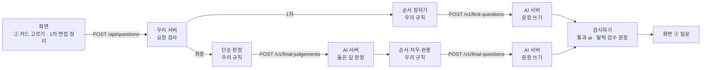

# AI API 명세 — 질문 문장 쓰기와 면접 답 판정

> API 명세(설계) · 2026-10-26 · 상태: **제안** — 형식은 우리 코드(`shared/providers/types.ts`) 기준이고, AI 담당 확인 전입니다
> 읽는 사람: **AI 파이프라인 담당**(우리 레포 코드를 몰라도 읽을 수 있게 썼습니다). 온보딩 문서 「질문 생성 파이프라인」과 같은 낱말을 씁니다(다른 점은 「온보딩 문서와 다른 점」).
> 예시 JSON: [`docs/api-examples/`](api-examples/) 6개 — 사람이 쓰지 않고 지금 코드가 만든 값입니다(단위 시험이 계속 비교).

## 이 문서로 할 일

AI 담당 서버에 아래 **호출 3가지**를 만들어 주세요. 우리 서버(Vercel 함수)가 부르고, 화면은 AI 서버를 직접 부르지 않습니다.

| 호출 | 하는 일 | 답하는 시간 |
|---|---|---|
| `POST {AI_ENDPOINT}/v1/first-questions` | 1차 면접 질문 5개의 문장 쓰기 | 8초 안 |
| `POST {AI_ENDPOINT}/v1/final-judgements` | 1차 면접에서 들은 답 판정 | 3초 안 권장 |
| `POST {AI_ENDPOINT}/v1/final-questions` | 최종 면접·처우 질문의 문장 쓰기 | 5초 안 권장 |

- **시간 제한**: 우리 서버는 **9초**에 끊습니다. 최종은 판정과 문장 두 호출이 9초 하나를 나눠 씁니다.
- **AI가 정하는 것**은 질문 문장(`text`)과 판정(`state`·`basis`)뿐입니다. 질문 개수·순서·유형·카드·근거 인용은 우리 규칙이 정해 요청에 담습니다.
- 늦거나 틀려도 화면은 멈추지 않습니다. 우리 서버가 그 문항을 미리 검수한 문장(검수 문장)으로 바꿉니다.

> **▲ 가장 큰 위험 — 근거 인용 규칙.** 문장 속 작은따옴표 인용('…'·‘…’)은 공고 원문과 **글자 그대로** 같아야 합니다. 띄어쓰기 하나만 빠지거나 더해져도 그 문항은 버려지고 검수 문장으로 나갑니다(원문의 연속 공백·줄바꿈은 한 칸으로 보고 비교합니다). `state: "absent"`(공고에 없음) 항목에 "공고에 … 있던데/있는데" 꼴로 쓴 문장도 버려집니다. 공고에 없는 업무를 전제하지 않는 것은 규칙이며, 검사는 이 꼴만 잡습니다(「응답 규칙」 3·4).

### 결정이 필요한 항목 (4건)

| | 항목 | 추천 | 누가 |
|---|---|---|---|
| ? 1 | 답하는 시간 1차 8초 · 판정 3초 · 문장 5초 | 이대로. 판정이 어려우면 `{ "judgements": [] }`만 돌려줘도 단순 판정으로 돕니다 | AI 담당 → 세진 |
| ? 2 | AI 서버 주소(`AI_ENDPOINT`)와 키(`AI_API_KEY`) 넘기는 방법 | 키는 메신저에 붙이지 않고 세진이 Vercel 환경변수에 직접 넣기 | AI 담당 · 세진 |
| ? 3 | 공고 분석 7건을 AI 파이프라인으로 다시 만들 시점(「부록 B」) | 호출 3가지보다 먼저. 문장의 근거가 분석에서 나옵니다 | AI 담당 |
| ? 4 | AI 서버가 쓰는 모델과 업체 · 처리 위치(국내/국외 이전 여부) · 하위 처리자 · 업체 쪽 보관 기간 · 학습 제외 설정 · 요청·응답 로그 보관 여부(「공통」 개인정보) | AI 담당이 적어 회신. 업체 쪽 보관 기간은 0일, 학습 제외는 켜기를 권장. 받은 내용은 /about-ai 위탁 고지(D-224)에 씁니다 | AI 담당 → 세진 |

### 바뀌는 것과 바뀌지 않는 것

| | 지금(가짜 응답 모드) | AI 연결 뒤 |
|---|---|---|
| 질문 문장 | 가짜 공급자가 검수 문장 앞에 앞말을 붙임 | AI 서버가 씀(검사 통과분만) |
| 들은 답 판정 | 예시 세트만 고정값, 나머지는 단순 판정 | AI 서버가 판정(검사 통과분만) |
| 질문 개수·순서·유형·근거, 화면, 「부록 A」 형식 | 우리 규칙 | **그대로** |
| 배포 | `build:mock` | 세진이 전환 시점을 정함(README 「실제 AI 연결」) |

## 흐름 — 화면에서 AI 서버까지



공고 분석은 AI 파이프라인이 미리 만들어 우리 데이터로 넣고(「부록 B」), 위 흐름은 그 분석을 읽기만 합니다.

### 화면 입력 → 요청 값

| 화면 입력 | 우리 서버로(`/api/questions`) | AI 요청으로 |
|---|---|---|
| 지원 건(S1 면접 준비 버튼) | `wantedAuthNo` | `posting`: 그 공고 원문 전체 |
| ② 카드 라디오 "기대돼요" · "걱정돼요" · "모르겠어요" | `picks[].pref` = `want` · `avoid` · `unsure` | 상위 5개 카드만 `items[].pref` |
| 경험 한 줄(100자) | `experience` | `experience`(붙일 질문이 있을 때만, 없으면 `""`) |
| 경험을 붙일 카드(이력서 칩, 없으면 처음 고른 "기대돼요" 카드) | `picks[].has_exp` | `items[].has_exp`, `template_text`에 경험이 들어감 |
| 1차 면접 정리 "물어봤어요" | `review.asked[]` | 판정 호출 `items[]`(들은 답이 있을 때만) |
| "못 물어봤어요" | `review.not_asked[]` | 판정에 넣지 않음(단순 판정) |
| 들은 답(100자) | `review.asked[].heard` | 판정 호출 `items[].heard`만 |
| "구체적이었어요" · "모호했어요" | `review.asked[].clarity` = `clear` · `vague` | 판정 호출 `items[].clarity` |
| 못 물은 이유: "시간이 없었어요" `no_time` · "분위기가 아니었어요" `bad_mood` · "잊어버렸어요" `forgot` · "질문할 기회가 없었어요" `no_chance` · "회사가 먼저 설명해 줬어요" `explained` | `review.not_asked[].reason` | 보내지 않음. `bad_mood` → 그 질문 완충, `explained` → 확인됨 |
| 회사가 물어본 업무(카드 17개 체크) | `review.received[].card_id` | 문장 호출 `items[].origin: "received"` |
| 면접 분위기 "편했어요" `relaxed` · "보통이었어요" `normal` · "압박이 있었어요" `pressured` | `review.impression.mood` | 문장 호출 `items[].tone` · `cushion` |

우리 서버가 AI 요청을 만드는 방법:

1. **다듬기** — 모르는 카드와 같은 카드의 두 번째 선택을 뺍니다. 경험 한 줄·들은 답은 화면이 100자로 막고, 우리 서버는 100자를 넘으면 400(`invalid_request`, `field` `experience`·`review`)으로 거절합니다(「부록 A」 오류 형식).
2. **`posting`** — `wantedAuthNo`의 공고 원문 한 건 전체를 담습니다.
3. **1차 `items`** — 카드마다 공고 상태(분석에 없으면 `absent`) × 내 선호로 유형·우선순위를 정해 상위 5개만 담습니다. 질문 틀의 `{anchor}`에 경험을 붙여 `template_text`를 만듭니다.
4. **판정 `items`** — 물어봤고 들은 답이 있는 카드만(고르지 않은 카드는 `pref: "none"`). 없으면 판정 호출을 하지 않습니다.
5. **최종 `items`** — 판정을 합친 뒤 우리 순서 규칙으로 카드 질문 5개 이하 + 처우 질문 3개 이하(합쳐 8개 이하)를 고르고 완충을 정합니다. 확인됨 카드는 빠지고, 들은 답은 넣지 않습니다.

## 공통

- **주소**: `{AI_ENDPOINT}/v1/<호출>`. `AI_ENDPOINT`는 우리 서버 환경변수입니다(예: `https://ai.example.com`, 끝 `/`는 우리가 뗍니다). 버전 경로는 `/v1`, 형식을 깨는 변경은 `/v2`로 따로 둡니다.
- **`AI_ENDPOINT`는 https만**입니다(로컬 시험용 `http://localhost`·`http://127.0.0.1`은 예외). 그 밖의 주소면 키를 평문으로 보내지 않도록 우리 서버가 부르지 않고 모두 검수 문장으로 냅니다.
- **인증**: 머리글 `Authorization: Bearer <AI_API_KEY>`. 키는 우리 서버 환경변수 `AI_API_KEY`에만 있습니다. 틀리면 401과 오류 형식으로 답해 주세요. 운영(Production)에서 키가 비어 있으면 우리 서버가 부르지 않고 모두 검수 문장으로 냅니다. 로컬·Preview는 키 없이도 부릅니다(머리글 없음).
- **요청·응답**: `POST`, `Content-Type: application/json; charset=utf-8`, `Accept: application/json`. 본문은 UTF-8 JSON(한글 그대로)이고, 응답도 HTTP 200 + UTF-8 JSON 하나입니다.
- **시간 제한**: 우리 서버는 9초에 끊습니다. 1차는 8초 안, 최종은 판정 + 문장 합계 9초 안입니다(판정 3초·문장 5초 권장). 판정이 9초를 다 쓰면 문장 호출은 하지 않습니다. 실패해도 다시 부르지 않습니다.
- **개인정보**: 요청 본문 전체와 응답 본문 전체를 저장·기록·학습에 쓰지 않습니다(로그·오류 `message` 포함). 로그에는 `card_id`/`key`, 글자 수, 처리 시간, 모델 이름만 남겨 주세요. 경험 한 줄(`experience`)과 들은 답(`heard`)은 AI 쪽에서도 저장·기록하지 않습니다. 두 필드만 빼서는 안 되는 까닭: 경험 한 줄은 1차 `items[].template_text`(`has_exp` 항목)와 응답 `questions[].text`에도 그대로 들어가고, 판정 `basis`도 들은 답을 바꿔 쓴 글입니다. 우리 서버도 저장·기록하지 않습니다.
- **최종 문장 호출에는 들은 답을 보내지 않습니다**(`/v1/final-questions`). 질문이 1차 면접관 말을 옮기지 않게 하려는 것입니다.
- **예시 값**: 회사·공고·인물은 시연용 가명입니다(`(주)OO소프트`, 김00).

### 공고 `posting`

세 호출 모두 공고 한 건을 그대로 보냅니다. 필드 이름은 고용24 채용정보 API 상세 명세 그대로(`wantedAuthNo` · `corpNm` · `wantedTitle` · `jobCont` …)이고 우리 표시 `draft`(임시 공고)가 하나 더 있습니다. 빈 문자열은 공고에 적혀 있지 않다는 뜻입니다. 근거 인용이 올 수 있는 칸(`evidence.field`)은 `jobCont` 직무내용 · `pfCond` 우대조건 · `etcPfCond` 기타 우대 · `empTpNm` 고용 형태 · `salTpNm` 임금 형태 · `sal` 임금 · `workdayWorkhrCont` 근무 시간 · `etcWelfare` 복리후생 8개이고, `{ "field": "pfCond", "quote": "고객사 상주 가능자" }` 꼴입니다.

## API 1 — 1차 질문 문장 `POST /v1/first-questions`

예시: [`first-request.json`](api-examples/first-request.json) → [`first-response.json`](api-examples/first-response.json)(예시 구직자 A × (주)OO소프트)

**요청** `{ "mode": "first", "posting": {…}, "experience": "…", "items": [ … 5개 ] }`

| `items[]` 필드 | 뜻 |
|---|---|
| `rank` · `card_id` · `card_label` | 순위 1~5 · 업무 카드 ID(`BE01`~`BE17`, 응답에 그대로) · 카드 이름 |
| `pref` | `want` 기대돼요 · `avoid` 걱정돼요 · `unsure` 모르겠어요 |
| `state` | 공고 상태: `explicit` 적혀 있음 · `inferred` 유추 · `vague` 모호함 · `absent` 공고에 없음 |
| `type` | `conflict` 차이 확인 · `opportunity` 기회 확인 · `depth` 깊이 확인 · `prevent` 미리 확인 · `explore` 탐색 |
| `evidence` | 공고 근거 인용(없으면 키가 없음) |
| `template` · `template_text` | 질문 틀(`{anchor}` = 경험 자리) · 검수 문장(틀 + 경험, AI가 실패하면 나가는 문장이자 뜻의 기준). `template_text`에는 경험 한 줄이 들어 있을 수 있음 — 기록 금지 |
| `has_exp` | `true`면 이 질문에만 경험 한 줄을 살려 씁니다 |

**응답** `{ "questions": [ { "card_id", "text", "evidence"? } ], "model"?: string }` — `card_id`(요청 그대로)·`text`(질문 문장)는 필수입니다. `text`에는 경험 한 줄이 들어 있을 수 있음 — 기록 금지. `evidence`는 돌려주지 않아도 됩니다. 돌려줘도 우리 서버는 요청의 근거를 씁니다(돌려준다면 요청 값 그대로, `null`도 됨. 모양이 틀리면 그 문항은 검수 문장). `model`은 문제를 찾을 때 볼 모델 이름이고 우리 서버는 읽지 않습니다.

## API 2 — 최종 질문: 판정 → 문장

명세 하나에 호출 두 번입니다. 판정을 받은 뒤 **우리 규칙이 순서를 정하고** 그 순서로 문장을 부탁합니다. 예시는 R-04 예시 세트(1차 면접 다녀온 것으로 채우기)입니다.

### 판정 `POST /v1/final-judgements`

예시: [`final-judgements-request.json`](api-examples/final-judgements-request.json) → [`final-judgements-response.json`](api-examples/final-judgements-response.json)

**요청** `{ "mode": "final", "posting": {…}, "items": [ … ] }` — 물어봤고 들은 답이 있는 카드만

| `items[]` 필드 | 뜻 |
|---|---|
| `card_id` · `card_label` | 카드 ID · 이름 |
| `pref` | `want` · `avoid` · `unsure` · `none`(고르지 않은 카드) |
| `heard` | 들은 답(100자 이내). 판정에만 쓰고 저장·기록하지 않습니다 |
| `clarity` | `clear` 구체적이었어요 · `vague` 모호했어요(안 골랐으면 키가 없음) |
| `watch_out` · `good_sign` | 주의할 답(기대와 다르거나 걱정이 맞는 답) · 좋은 신호 |

**응답** `{ "judgements": [ { "card_id", "state", "basis" } ], "model"?: string }` — `state`는 `confirmed` 확인됨 · `mismatch` 기대와 다름 · `still_unknown` 아직 모름, `basis`는 판정 근거 한 줄(1~160자, 해요체, 화면에 보임)입니다. `basis`에는 들은 답을 바꿔 쓴 글이 들어 있을 수 있음 — 기록 금지. "기대와 다름"은 AI만 낼 수 있습니다. 판단이 어려운 카드는 빼도 됩니다(그 카드는 단순 판정).

### 문장 `POST /v1/final-questions`

예시: [`final-questions-request.json`](api-examples/final-questions-request.json) → [`final-questions-response.json`](api-examples/final-questions-response.json)

**요청** `{ "mode": "final", "posting": {…}, "items": [ … 8개 이하 ] }` — 들은 답 없음

| `items[]` 필드 | 뜻 |
|---|---|
| `rank` · `key` | 순위 1~8 · 카드 ID 또는 `offer:<topic>`(처우 질문, 응답에 그대로) |
| `card_id` · `topic` · `label` | 카드 질문은 `card_id`, 처우 질문은 `topic`(`sal` 임금 · `workHours` 근로시간 · `probation` 수습 · `onsite` 상주 근무 조건) · 이름 |
| `type` | `recheck` 다시 확인 · `signal` 신호 확인 · `scope` 범위 확인 · `offer` 처우 확인 · `opportunity` 기회 확인 |
| `origin` | `asked` 물어본 질문 · `not_asked` 못 물은 질문 · `received` 회사가 물어본 업무 · `offer` 처우 |
| `state` · `review_state` | 카드 질문만: 공고 상태 · 1차 면접 뒤 상태(`confirmed` · `mismatch` · `still_unknown` · `company_signal`) |
| `evidence` | 공고 근거 인용(있을 때만, 처우 질문 포함) |
| `tone` · `cushion` | `basic` 기본 · `cushion` 완충(앞에 `cushion` 문장) · `direct` 앞말 없이 바로. 완충이 아니면 `cushion`은 `""` |
| `template` · `template_text` | 완충을 뺀 검수 문장 · 완충 + 검수 문장(실패하면 나가는 문장) |

**응답** `{ "questions": [ { "key", "text", "evidence"? } ], "model"?: string }` — API 1 응답과 같고 `card_id` 대신 `key`입니다. `key`(요청 그대로)·`text`는 필수입니다. `evidence`는 돌려주지 않아도 됩니다. 돌려줘도 우리 서버는 요청의 근거를 씁니다(돌려준다면 요청 값 그대로).

## 응답 규칙

규칙마다 우리 서버가 기계로 검사하는지 적었습니다. **[검사함]** 걸리면 그 문항만 검수 문장(판정은 그 카드만 단순 규칙)으로 바뀝니다. **[검사 안 함]** 우리 서버가 잡지 못하니 AI 담당이 지켜 주세요. 어기면 그대로 화면에 나갈 수 있습니다.

1. **JSON만** — 본문은 JSON 하나입니다. 설명 글·코드 울타리(백틱 세 개)·인사말을 붙이지 않습니다. **[검사함]** JSON이 아니면 그 호출 전체가 검수 문장이 됩니다.
2. **짝 그대로** — 요청 `items[]`마다 하나씩, **순서와 개수를 바꾸지 않고** 돌려줍니다. 1차·판정은 `card_id`, 최종 문장은 `key`를 그대로 씁니다. **[검사함]** 우리 서버는 이 값으로 짝을 맞추므로 빠진 항목은 검수 문장이 되고, 요청에 없는 항목은 버립니다. **[검사 안 함]** 순서·개수 — 바뀌어도 짝을 맞춰 우리 규칙 순서로 다시 놓습니다(같은 값이 두 번 오면 앞의 것).
3. **근거 인용은 글자 그대로** — 문장 속 인용은 작은따옴표('…' 또는 ‘…’)만 쓰고, 공고 원문 어느 칸과 **글자 그대로** 같아야 합니다. 카드 이름 인용('고객사 상주 개발')만 예외입니다. 바꿔 쓰려면 따옴표를 빼고 풀어 씁니다. **[검사함]** 작은따옴표 인용(원문의 연속 공백·줄바꿈은 한 칸으로 보고 비교, 두 칸에 걸친 인용은 받지 않음). **[검사 안 함]** 큰따옴표·「」 인용 — 검사하지 않지만 쓰지 마세요. `evidence`를 돌려준다면 요청 값 그대로 둡니다(요청의 `evidence.quote`는 `posting[evidence.field]` 원문 글자 그대로입니다). **[검사함]** `evidence`는 모양만(칸 이름이 8개 밖이거나 `quote`가 빈 글이면 그 문항 검수 문장). 값은 읽지 않고 요청의 근거를 씁니다.
4. **공고에 없는 업무를 있다고 전제하지 않음** — 공고에 없는 업무를 있는 것처럼 묻지 않습니다. **[검사함]** `state: "absent"` 항목에 "공고에 … 있던데/있는데" 꼴. **[검사 안 함]** 그 밖의 꼴 — 전제하지 않는 것은 규칙이며 검사는 이 꼴만 잡습니다.
5. **금지어** — 채용 금지 항목과 회사를 깎아내리는 말을 쓰지 않습니다. 판정 `basis`도 같습니다. **[검사함]** 이 낱말들: 나이(앞 글자가 한글이면 낱말 일부로 보고 걸지 않음 — "업무 중 하나이고"는 통과)·연령·몇 살 · 결혼·기혼·미혼·이혼·배우자(배우자가·배우자의·배우자와·배우자분·배우자님처럼 사람을 가리킬 때) · 출신·고향·본적지 · 종교·신앙 · 임신·출산 계획·자녀 계획 · 혈액형·외모·신체 조건·키와 몸무게 · 부모 직업·부모 재산·가족 관계 · 정치 성향·지지 정당 · 나쁜 회사·블랙 기업·악덕. **[검사 안 함]** 목록에 없는 말로 같은 뜻을 묻는 것.
6. **1차 면접관 말 인용 금지(최종)** — 1차 면접관이 한 말을 옮기지 않습니다. **[검사함]** "아까" "하셨는데" "말씀하신" 세 낱말. **[검사함]** 6자 이상인 들은 답이 문장에 글자 그대로 있으면 그 문장은 버립니다(`interviewer_quote`). 최종 문장 호출에는 들은 답을 보내지 않으므로, 들은 답이 카드 낱말과 같으면 우연히 걸릴 수 있습니다.
7. **길이** — 질문 문장 10~260자(공백·줄바꿈은 한 칸으로 셈), 판정 `basis` 1~160자. **[검사함]**
8. **문체** — 질문 문장은 면접에서 그대로 말할 비즈니스체입니다. 서술은 "…습니다", 질문은 "…인가요?"·"…있나요?"("…해요"체 아님). `template_text`의 뜻을 바꾸지 않고, `has_exp` 질문은 경험 문장을 살립니다. `cushion`이 있으면 맨 앞에 그대로, `tone: "direct"`면 앞말 없이 씁니다. **[검사 안 함]** 문체·뜻·경험 문장·`cushion` 모두 AI 담당 책임입니다.
9. **판정 `basis`에 들은 답을 옮기지 않음** — 6자 이상인 들은 답을 통째로 `basis`에 넣으면 그 판정은 받지 않습니다. 일부만 옮기는 것은 검사하지 않지만, 옮기지 말고 이유만 해요체 한 줄로 쓰세요. **[검사함]** 통째로 넣은 것. **[검사 안 함]** 일부만 옮긴 것.
10. **오류 응답** — 처리할 수 없으면 HTTP 4xx·5xx와 `{ "error": { "code": string, "message": string } }`로 답합니다. 예: 400 `invalid_request`(본문 모양이 틀림) · 401 `unauthorized`(키 없음·틀림) · 429 `rate_limited` · 500 `internal` · 503 `unavailable`(모델 준비 중·과부하). `message`에 요청 내용을 넣지 않습니다. **[검사 안 함]** 우리 서버는 오류 본문을 읽지 않고 상태만 봅니다(상태와 관계없이 그 호출 전체 검수 문장).

```json
{ "error": { "code": "invalid_request", "message": "items is empty" } }
```

## 실패 처리

우리 서버는 어떤 실패에도 화면에 HTTP 200으로 질문을 돌려줍니다. 바꾼 질문은 `source: "template"`(화면 라벨 "검수 문장")입니다.

| 무엇이 | 우리 서버가 하는 일 |
|---|---|
| 문항 하나의 모양이 틀림(`card_id`·`key` 없음, `text`가 글이 아님, `evidence` 칸 이름이 틀림), 검사에 걸림(인용·없는 업무 전제·금지어·면접관 말·길이), 빠짐 | 그 문항만 검수 문장 |
| 판정 하나의 모양이 틀리거나 `basis`가 규칙에 걸림 | 그 카드만 단순 규칙 판정 |
| HTTP 4xx·5xx, JSON 아님, 바깥 모양이 틀림(`questions`·`judgements` 배열 없음), 연결 오류 | 그 호출의 문항 모두 검수 문장(판정 호출이면 모든 카드가 단순 규칙 판정, 문장 호출은 그대로 함) |
| 시간 초과(1차·최종 합쳐 9초) | 1차: 모두 검수 문장. 최종 판정 단계에서 시간 초과: 모든 카드가 단순 규칙 판정이고 문장 호출을 하지 않아 모두 검수 문장. 최종 문장 단계에서 시간 초과: 제때 받은 AI 판정은 그대로 쓰고 문장만 모두 검수 문장 |
| `AI_ENDPOINT`가 없음·https가 아님(localhost 밖), 운영인데 `AI_API_KEY`가 없음 | 부르지 않고 모두 검수 문장, 판정은 단순 규칙 |

단순 규칙 판정: 물어봤고 "구체적이었어요" → 확인됨(단 "걱정돼요" 카드는 아직 모름) · "모호했어요"·안 고름 → 아직 모름 · 못 물어봤어요 → 아직 모름("회사가 먼저 설명해 줬어요"면 확인됨) · 회사가 물어본 업무 → 회사가 먼저 물은 것. 오류 본문은 읽지 않고, 우리 서버 로그에는 공급자 이름·검수 문장 수·걸린 검사 이름·실패 종류만 남깁니다.

## 온보딩 문서와 다른 점

- 온보딩 5절은 우리 레포 `shared/providers/ennoia.ts`를 채우는 방법이었습니다. 이 명세로는 **AI 서버에 호출 3가지를 만들면 되고 우리 코드를 고치지 않습니다.** 우리 쪽 연결(`LLM_PROVIDER=remote`, `AI_ENDPOINT`, `AI_API_KEY`)은 이미 있고, 엔노이아 자리는 그대로 둡니다.
- 온보딩 2-5·3-1절의 `Draft[]`·`{ card_id, state, basis }`는 HTTP에서 `{ "questions": [...] }`·`{ "judgements": [...] }`로 한 번 감쌉니다. 판정 요청에도 `posting`이 들어갑니다.
- "순서를 바꾼 응답도 규칙 순서로 다시 맞춘다"는 지금도 그렇지만, 명세 규칙은 순서·개수를 바꾸지 않는 것입니다.
- 레포 경로가 `D:/SejinSource/askback24`로 바뀌었습니다(온보딩 5절 명령).

## 부록 A — 화면 → 우리 서버 `POST /api/questions`

화면이 우리 서버 `POST /api/questions`(Vercel 함수)에 보내는 요청과 받는 응답입니다(지금 계약 그대로, `shared/contract.ts`). AI 서버는 이 주소를 부르지 않습니다. 1차·최종을 `mode` 하나로 나눕니다.

- **요청 1차** `{ "mode": "first", "wantedAuthNo", "picks": [ { "card_id", "pref", "has_exp" } ], "experience"? }` — `picks`는 고른 순서(17개 이하), `experience`는 100자 이내이고 붙일 카드가 없으면 뺍니다.
- **요청 최종** `{ "mode": "final", "wantedAuthNo", "picks", "review": { "asked": [ { "question_id", "card_id", "heard", "clarity"? } ], "not_asked": [ { "question_id", "card_id", "reason"? } ], "received": [ { "card_id" } ], "impression": { "mood" } } }` — `question_id`는 1차 질문 순번(`q1`~), 경험 한 줄은 보내지 않습니다.
- **응답 1차** `{ "mode": "first", "questions": [ { "rank", "card_id", "type", "text", "evidence"?, "basis", "watch_out", "good_sign", "has_exp", "source" } ], "elapsed_ms" }`
- **응답 최종** `{ "mode": "final", "card_states": [ { "card_id", "state", "basis", "source", "carry" } ], "final_questions": [ { "rank", "card_id"?·"topic"?, "type", "priority", "text", "basis", "evidence"?, "watch_out", "good_sign", "source" } ], "summary": { "confirmed", "mismatch", "still_unknown", "company_signal" }, "elapsed_ms" }`

`source`는 `ai`(검사 통과) · `template`(검수 문장) · `rule`(단순 판정)입니다. `basis`·`watch_out`·`good_sign`은 분석과 카드 데이터에서 오고 AI가 만들지 않습니다. 오류는 400 `invalid_json`·`invalid_request`, 404 `unknown_posting`, 405 `method_not_allowed`, 413 `body_too_large`, 500 `internal`이고 본문은 `{ "error": "<code>", "field"?: string }`입니다(AI 서버 오류 형식과 다름). `field`는 `invalid_request`일 때만 붙는 걸린 필드 이름(`mode` · `wantedAuthNo` · `picks` · `experience` · `review`, 본문이 객체가 아니면 `body_not_object`)이고 입력값은 넣지 않습니다. 화면은 12초 안에 답이 없거나 오류면 같은 규칙의 검수 문장으로 대신합니다.

## 부록 B — 공고 분석 데이터 `data/analysis/<wantedAuthNo>.json`

공고 분석은 AI 파이프라인이 미리 만들어 우리 레포 `data/analysis/<wantedAuthNo>.json`으로 넣습니다(공고 한 건에 파일 하나). 화면과 우리 서버는 이 파일을 **읽기만** 합니다. 지금 7건(`K-MOCK-0001`~`0007`)은 사람이 이 모양으로 쓴 것이라 다시 만들어 덮어쓰면 됩니다.

```json
{
  "wantedAuthNo": "K-MOCK-0001",
  "cards": [
    { "card_id": "BE07", "state": "vague",
      "evidence": { "field": "jobCont", "quote": "기타 업무 지원" },
      "reason": "'기타 업무 지원'은 범위가 모호해 기존 시스템 유지보수가 포함될 수 있어요" }
  ],
  "blanks": [
    { "topic": "workHours", "status": "missing", "label": "근로시간", "basis": "공고에 근무 시간이 없어요",
      "question": "근무 시간이 공고에 적혀 있지 않은데, 출퇴근 시간과 주 근로시간은 어떻게 되고 …?" }
  ]
}
```

| 필드 | 뜻과 규칙 |
|---|---|
| `wantedAuthNo` | 파일 이름과 같은 공고 번호(`data/postings.json`에 있어야 함) |
| `cards[]` | 공고가 다루는 카드만 한 번씩. 없는 카드는 `absent`(공고에 없음) |
| `cards[].card_id` | `BE01` 신규 API 개발 · `BE02` 서비스 구조 설계 · `BE03` DB 테이블 설계 · `BE04` SQL 작성·쿼리 개선 · `BE05` 외부 시스템 연동 · `BE06` 배치·정산 프로그램 · `BE07` 기존 시스템 유지보수 · `BE08` 장애 대응·온콜 · `BE09` 배포·서버 운영 · `BE10` 데이터 이전·시스템 전환 · `BE11` 테스트·품질 검증 · `BE12` 요구사항 협의 · `BE13` 화면 개발 겸업 · `BE14` 개발 문서·산출물 작성 · `BE15` 고객사 상주 개발 · `BE16` 보안 점검·취약점 조치 · `BE17` 혼자 맡는 백엔드 |
| `cards[].state` | `explicit` 적혀 있음 · `inferred` 유추 · `vague` 모호함 |
| `cards[].evidence` | 선택. `quote`는 `posting[field]` 원문의 **글자 그대로** 일부(화면 형광펜이 이 글자로 공고를 찾음). `inferred`인데 `evidence`가 없으면 화면은 그 카드를 "공고에서 유추"가 아니라 "공고에 없음"으로 표시합니다(공고 문장에서 유추한 것이 아니라 공고에 적히지 않은 점) |
| `cards[].reason` | 화면 말풍선 한 줄(해요체). 어디에 적혔는지만 말하지 않고 확인해 볼 이유를 말함. 회사를 평가하지 않음 |
| `cards[].questions` | 선택. 이 공고에서만 카드 질문 틀을 덮어씀(카드 틀이 근거와 맞지 않을 때만). 모양은 `{ "conflict" \| "opportunity" \| "depth" \| "prevent" \| "explore": "틀 문장" }` — 질문 유형 키(1차 `type`과 같은 이름)마다 틀 문장 하나, 필요한 유형만. 틀 문장에 `{anchor}`를 두면 그 자리에 경험 한 줄이 들어갑니다(없으면 경험을 붙이지 않음). 예: `K-MOCK-0007`의 `BE15` → `"questions": { "conflict": "물류센터 현장 지원에 개발자가 나가는 일이 있다면, 얼마나 자주 나가고 가서는 어떤 일을 맡게 되나요?" }` |
| `blanks[]` | 처우 질문 재료: `topic`(`sal`·`workHours`·`probation`·`onsite`) · `status`(`missing` 공고에 없음 · `vague` 모호 · `check` 확인 필요) · `label` · `basis` · `evidence`(선택, 인용 규칙 같음) · `question`(검수 처우 질문) |
| 화면의 "확인할 곳 N군데" | N = `cards[]` 중 카드 ID가 17개 안에 있는 것 전부(파일의 카드는 모두 `explicit`·`inferred`·`vague`) + `blanks[]` 중 `status`가 `missing`·`vague`인 것. `check`(적혀 있지만 물어볼 것)는 최종 처우 질문 재료라 세지 않습니다 |

넣은 뒤 확인하는 시험:

```bash
npm --prefix /d/SejinSource/askback24 run test:unit
```

인용이 원문에 글자 그대로 있는지·카드 ID·`reason`(`shared/data.test.ts`), 예시 구직자 A·B × 모든 공고의 질문이 검사를 통과하는지(`shared/postings.test.ts`)를 봅니다. 분석이 바뀌면 질문 순서 시험(`shared/rules.test.ts` API-01·02)이 깨질 수 있으니 우리 쪽에 알려 주세요(기대값은 우리가 고칩니다). 새 공고를 더하려면 `data/postings.json`과 `shared/catalog.ts`에 한 줄씩 더하는 우리 쪽 작업이 필요합니다.
