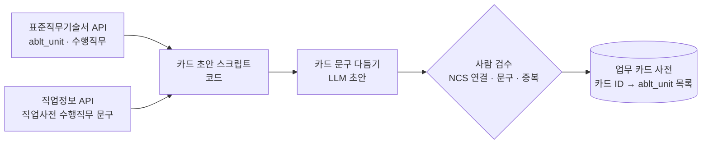
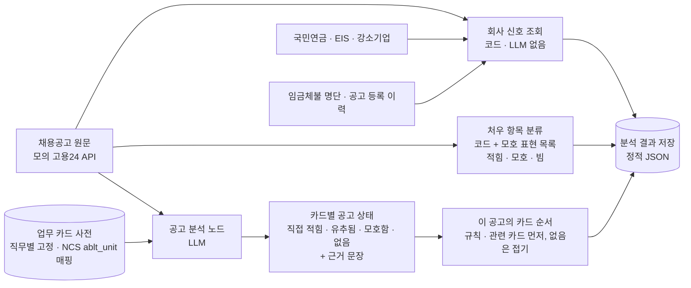
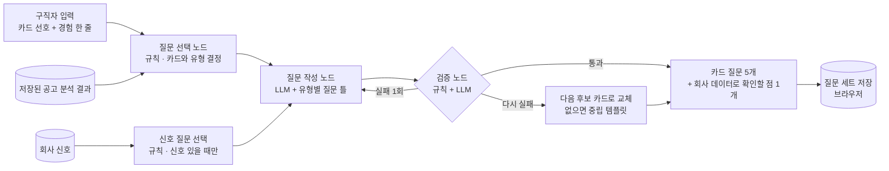
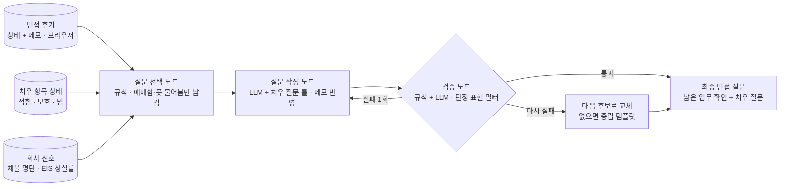
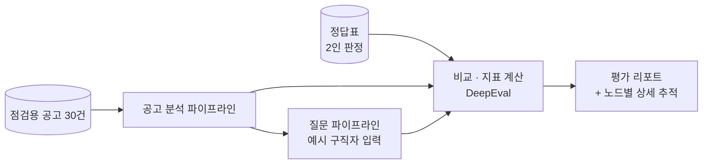

# 면접 역질문 서비스 에이전트 파이프라인

> **이 문서는 처음 설계안이에요.** 2026-10-27에 확정한 설계는 [에이전트 설계 확정](./에이전트%20설계%20확정.md)이고, 다른 부분은 확정 문서를 따라요(바뀐 것 목록은 확정 문서 7절).

## 0. 업무 카드 사전 준비 (오프라인 · 직무당 1회 · 사람 검수)

- 서비스가 돌 때 실행되는 파이프라인이 아니라, 개발 단계에서 직무마다 한 번 만드는 데이터 준비 작업이에요.
- MVP는 백엔드 1직무(17개)만 만들어요. 15개는 API에서 가져온 능력단위로 초안을 만들고, NCS에 없는 근무 방식 카드 2개는 사람이 직접 추가해요.
- 다른 직무로 넓힐 때 같은 절차를 반복하면 돼서, 확장 방법으로 설명할 수 있어요.

## 1. 공고 분석 파이프라인 (정적 · 공고당 1회 실행 후 저장)

- 업무 카드 사전: 공고마다 새로 만들지 않고, 직무별로 미리 만들어 둔 고정 목록이에요(백엔드 17개). 카드마다 NCS 능력단위 코드가 붙어 있어요.
- 공고 분석 노드: 사전의 카드마다 이 공고에서의 상태와 근거 문장을 붙여요. 결과는 구조화된 JSON으로 고정해요.
- 카드 순서(규칙): 직접 적힘·유추됨·모호함 카드를 먼저 보여주고, '없음' 카드는 접어 둬요. 그래서 2단계 화면의 카드가 공고마다 달라 보여요.
- 사전에 없는 업무가 공고에 나오면 '카드 밖 업무'로 따로 표시해 두고, 사전을 보강할 때 참고해요.
- 회사 신호 조회: 숫자는 LLM이 아니라 코드로 조회해 지어낼 위험 차단

* 처우 항목 분류(코드): 임금, 근무시간, 수습기간, 고용형태, 근무지 5개를 근로조건 필드에서 읽어요. 빈 값이거나 '회사 내규에 따름', '협의', '면접 후 결정' 같은 표현이 있으면 '모호'로 분류해요. 모호 표현 목록은 점검용 공고 30건을 보며 채워요. LLM은 쓰지 않아요.

## 2. 1차·기술 면접 질문 파이프라인 (동적 · 요청마다 실행)

- 대상: 실무진. 업무 내용, 근무 방식, 팀 구성을 다뤄요.
- 질문 생성은 두 단계예요. **무엇을 물을지(카드와 유형)는 규칙**으로 고르고, **질문 문장은 LLM**이 공고 근거 문장을 넣어 새로 써요. 질문 문장을 미리 정해 두지는 않아요.

### 질문 유형

- **충돌**: 걱정되는 업무가 공고에 있음 → 비중·범위를 확인
- **탐색**: 내가 모르겠거나 공고가 모호함 → 실제로 어떤 일인지 이해
- **깊이**: 기대하는 업무가 공고에 있음 → 실제로 얼마나, 어떻게 하는지
- **기회**: 기대하는 업무가 공고에 불분명하거나 없음 → 해볼 기회가 있는지
- **확인**: 걱정되는 업무가 공고에 없음 → 혹시 그 업무가 있는지 확인. 근거 자리에 "공고에 언급 없음"을 표시해요.

### 질문 선택 규칙표

| 공고 상태 \\ 내 선호 | 기대돼요 | 걱정돼요 | 모르겠어요 |
| --- | --- | --- | --- |
| 직접 적힘 | 깊이 | 충돌 | 탐색 |
| 유추됨 | 깊이 | 충돌 | 탐색 |
| 모호함 | 기회 | 충돌 | 탐색 |
| 없음 | 기회 | 확인 | 제외 |

- **우선순위**: 충돌 → 탐색 → 깊이 → 기회 → 확인 순으로 5개를 채워요.
- **다양성**: 카드 하나에서는 질문 1개만, 같은 유형은 최대 2개까지 뽑아요.
- **후보가 5개 미만**: 사용자가 선택하지 않았더라도 공고에서 '모호함'인 카드로 탐색 질문을 채워요.

### 회사 데이터로 확인할 점 (별도 1개)

- 카드 질문 5개와 별도로, 신호가 있을 때만 1개를 붙여요. 화면의 '회사 신호' 박스와 연결해 보여줘요.
- 조건: 공고 재등록 3회 이상, 또는 국민연금 상실이 취득보다 많음.
- 예: "이 포지션은 증원인가요, 충원인가요?", "지금 팀은 몇 명이고 어떻게 구성돼 있나요?"

### 경험 한 줄

- 질문 작성 노드가 질문 도입부를 맞추는 데만 써요. 질문 선택 규칙에는 반영하지 않아요.
- 200자 제한, 프롬프트 안에서는 '구직자 메모'로 감싸 지시가 아닌 데이터로 취급해요.

### 재생성

- 'AI 재생성'은 카드와 유형은 그대로 두고 문장만 새로 써요. 다른 카드를 원하면 2단계에서 선택을 바꿔요.
- 질문마다 '다른 질문으로' 버튼(다음 후보로 교체)은 시간이 남으면 추가해요.

> **면접 후기는 파이프라인이 아니라 화면 + 저장 기능이에요.** 사용자가 '면접 다녀왔어요' 화면에서 질문마다 상태(확인됨 · 애매함 · 못 물어봄)를 고르고 메모 한 줄을 남기면, 그대로 저장해요(LLM 없음). 이 결과가 최종 면접·처우 협의 파이프라인의 입력이 돼요.

## 3. 최종 면접·처우 협의 질문 파이프라인 (동적 · 요청마다 실행)

- 대상: 임원·대표. 1차에서 확인된 항목은 빼고, 남은 항목과 처우를 다뤄요.
- 처우 질문 순서: '빔' 항목 → '모호' 항목. 임금체불 명단에 있으면 처우 질문을 맨 앞으로 올려요.
- EIS로 본 같은 직종·규모·지역 평균보다 상실률이 높으면(추정), "입사 후 첫 3개월 동안 어떤 지원이 있나요?" 같은 정착 질문을 넣어요.
- 청년친화강소기업은 질문으로 만들지 않고 '좋은 신호'로만 표시해요.
- 검증 노드: 회사 신호를 단정적으로 말하지 않게 걸러요. '퇴사자가 많던데'가 아니라 '이 자리는 증원인가요, 충원인가요?'처럼 바꿔요.
- 1차 후기가 없으면(바로 최종 면접인 경우) 1차 항목도 모두 남은 항목으로 취급해요.

## 검증 노드 (1차·최종 공통)

| 검사 | 방식 | 실패 예 |
| --- | --- | --- |
| 근거 문장이 공고 원문에 있는지 | 규칙 (문자열 대조, '확인' 유형은 예외) | 공고에 없는 문장을 근거로 댐 |
| 카드 ID가 사전에 있는지 | 규칙 | 없는 카드를 만들어 냄 |
| 금지어 | 규칙 (목록) | 나이, 결혼, 출신 등 |
| 회사 신호 숫자가 조회값과 같은지 | 규칙 | 숫자를 지어냄 |
| 경험 한 줄 내용을 지어내지 않았는지 | 규칙 + LLM | 쓰지 않은 경험을 붙임 |
| 단정 표현, 무례한 어조 | LLM | "퇴사자가 많던데요" |

- 실패하면 1번 다시 써 보고, 그래도 실패하면 다음 후보 카드로 교체해요. 후보가 없으면 유형별 중립 템플릿을 써요.
- 재시도를 1회로 묶은 이유: 무료 서버 함수의 실행 시간 제한 안에서 응답하기 위해서예요.

## 4. 평가 파이프라인 (오프라인 · 로컬 실행)

| 지표 | 목표 | 측정 방법 |
| --- | --- | --- |
| 공고 분석 일치율 (카드 상태 4분류) | 90% 이상 | 정답표와 비교 |
| 근거 문장 실재율 | 100% | 공고 원문과 문자열 대조 |
| 질문의 근거 없는 전제 | 0건 | 검증 규칙 + LLM 판정 + 표본 사람 확인 |
| 금지어 포함 | 0건 | 규칙 |

- 정답표: 두 사람이 15건씩 나눠 판정하고, 5건은 둘 다 판정해 일치율을 확인해요. 어긋난 카드는 기준을 다시 맞추고, 그 기준을 공고 분석 프롬프트의 예시로 써요.
- 노드별 상세 추적은 이 평가에서만 켜요. 모의 데이터라 개인정보가 없어요.

## 저장과 운영

| 데이터 | 저장 위치 |
| --- | --- |
| 업무 카드 사전, 공고 분석 결과, 처우 항목 상태, 회사 신호 | 정적 JSON (배포 파일에 포함) |
| 구직자 선택, 경험 한 줄, 질문 세트, 면접 후기 | 브라우저 localStorage |

- 파이프라인끼리 직접 연결하지 않고 저장소를 사이에 두고 이어져요. 각각 따로 개발·테스트할 수 있어요.
- 같은 브라우저에서만 이어 쓸 수 있어요. 실서비스에서는 고용24 로그인과 연동해요.
- 동시 사용: 구직자 데이터는 각자 브라우저에, 정적 JSON은 읽기 전용, 질문 생성은 요청마다 새로 돌아서 서로 섞이지 않아요. 서버 함수에 전역 변수로 상태를 두지 않아요.
- LLM 실패 대비: 시연용 공고 3건 × 예시 구직자 2명의 결과를 미리 생성해 캐시하고, 호출이 실패하면 캐시로 대체해요. 엔노이아의 동시 호출 한도도 확인해요.
- 운영 로그: 카드 ID, 유형, 검증 결과와 실패 사유, 재시도 횟수, 응답 시간만 남겨요. 경험 한 줄과 질문 원문은 남기지 않아요.
