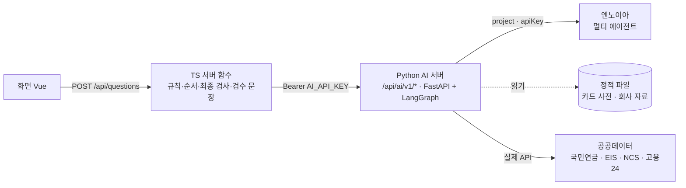
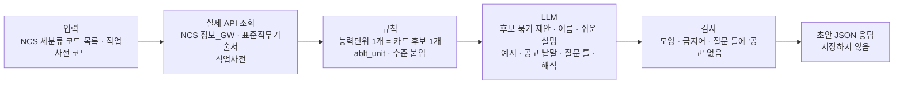
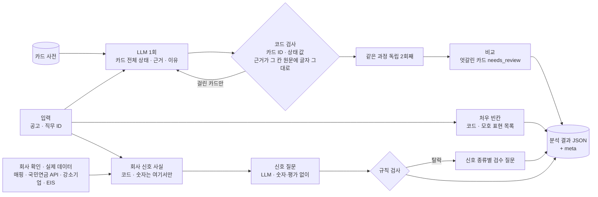
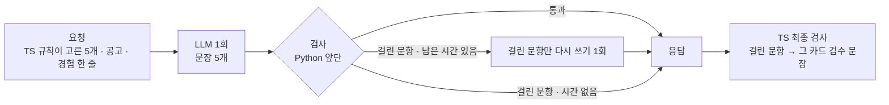
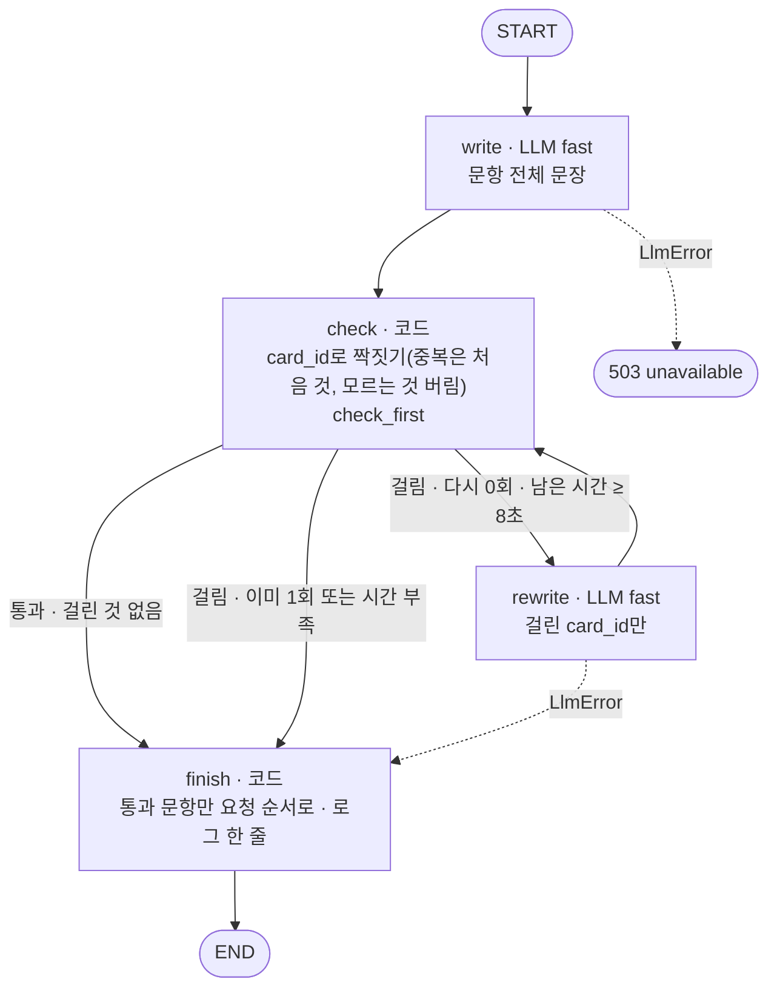
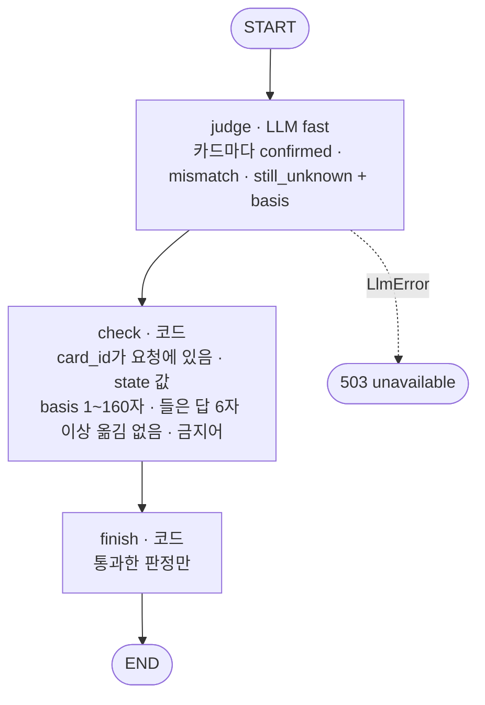
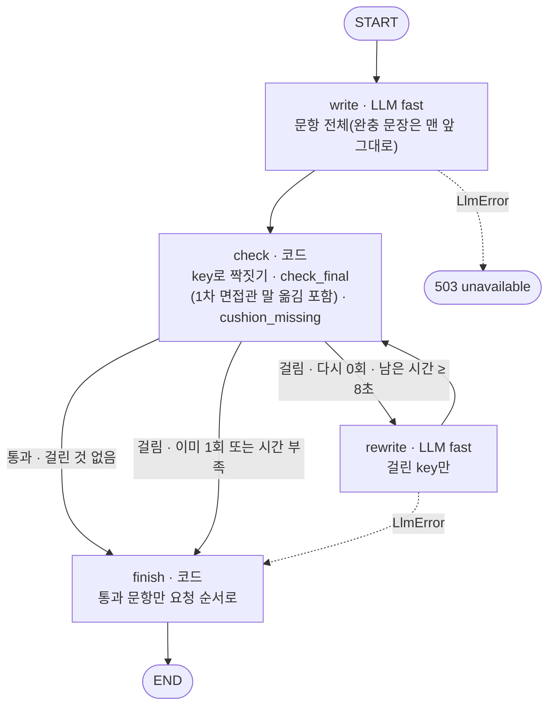
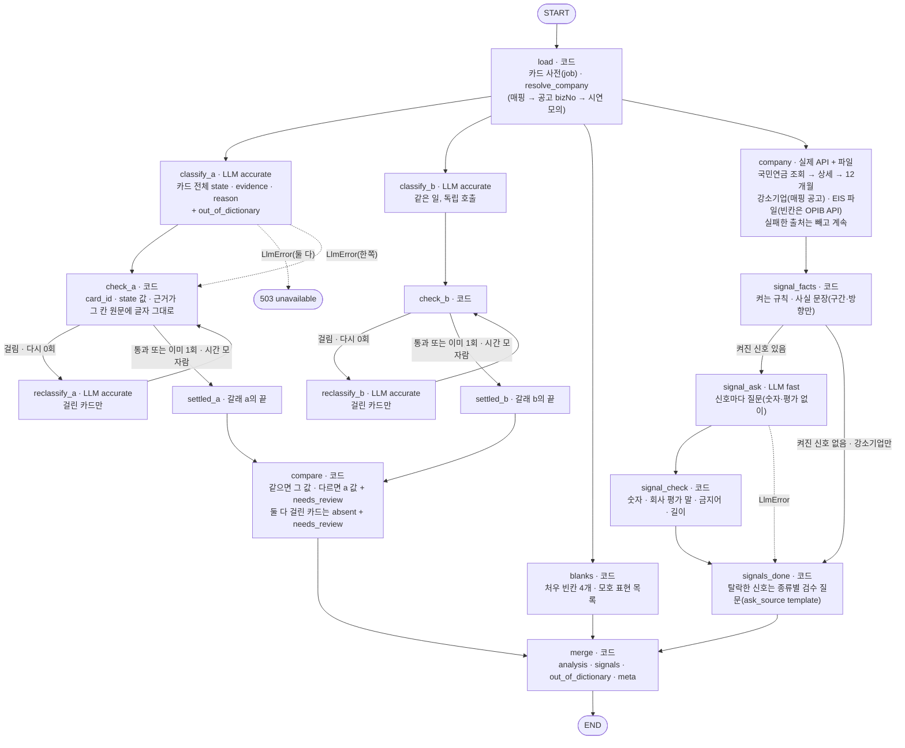
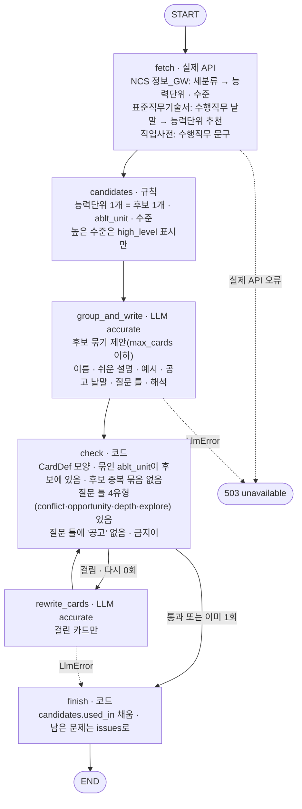

# 에이전트 설계 확정

> 2026-10-27 설계 그릴링으로 확정. 같은 폴더의 「에이전트 파이프라인」·「사용 데이터 정리」와 다르면 **이 문서를 따른다**. 결정마다 `docs/DECISIONS.md` D-302~D-326, 말뜻은 루트 `GLOSSARY.md`, 호출 형식은 `docs/AI-API-명세서.md`.

## 1. 전체 구조



- 화면은 언제나 TS `/api/*`만 부른다. 나중에 화면이 ⓪·①을 써야 하면 TS가 대신 부른다(키가 화면 번들에 들어가지 않게).
- **무엇을 물을지(카드·유형·순서·근거)는 TS 규칙(`shared/`)만 정한다.** Python은 문장을 쓰고 판정하고 공고를 분석할 뿐, 순서 규칙을 따로 갖지 않는다.
- 마지막 검사와 검수 문장 대체는 TS가 한다(`shared/validate.ts`·`generate.ts`). Python의 검사는 다시 쓸지 정하는 앞단 검사다.
- 파이프라인끼리는 저장소(정적 JSON·브라우저 저장)를 사이에 두고 이어진다. 서버 함수에 전역 상태를 두지 않는다.

### 코드 자리

| 자리 | 내용 |
|---|---|
| `api/ai/index.py` | FastAPI 앱 하나. `vercel.json`에서 `/api/ai/(.*)` → 이 함수 |
| `api/_agent/` | Python 패키지: `llm.py`(엔노이아), `checks.py`(검사), `graphs/`(에이전트마다 그래프), `schemas.py`(pydantic) |
| `api/_agent/tests/` | pytest. 가짜 LLM(고정 응답)으로 돈다 |
| `shared/fixtures/validate-cases.json` | 검사 예시(입력 → 기대 결과). Vitest와 pytest가 같이 읽는다 |
| `evals/` | ④ 평가 스크립트(로컬만, 배포 안 함) |
| `pyproject.toml` | Python 3.12, `uv`. `npm run test:py`가 pytest를 부르고 `npm run check`에 들어간다 |

## 2. 에이전트 4개 (+ 평가)

| | 주소 | 무엇을 | LLM | 지금 쓰는 곳 |
|---|---|---|---|---|
| ⓪ 업무 카드 초안 | `POST /api/ai/v1/card-drafts` | 직무 하나의 업무 카드 사전 초안 | 글 초안만 | 직무를 넓힐 때 |
| ① 공고 분석 | `POST /api/ai/v1/posting-analysis` | 공고 한 건의 카드 상태·근거·처우 빈칸·회사 신호 | 상태 판정·이유·신호 질문 | 당분간 시연 공고 7건 다시 만들기 |
| ② 1차 질문 | `POST /api/ai/v1/first-questions` | 1차 질문 5개 문장 | 문장 | 화면 |
| ③ 최종 질문 | `POST /api/ai/v1/final-judgements` · `final-questions` | 1차 답 판정 → 최종·처우 질문 문장 | 판정 · 문장 | 화면 |
| ④ 평가 | API 아님 (`evals/`) | 지표 계산 | 판정용 | 로컬 |

모든 주소는 `Authorization: Bearer {AI_API_KEY}`를 요구하고 서버끼리만 부른다.

각 에이전트의 LangGraph 노드·간선·상태는 **9절 그래프 정의**에 있다.

### ⓪ 업무 카드 초안 (규칙 뼈대 + LLM 글 + 사람 검수)



- 사실(어느 능력단위가 어느 카드인지, `ablt_unit`, 수준, 직업사전 수행직무)은 규칙이 정한다. 묶음 제안의 근거(묶인 능력단위 목록)는 초안에 그대로 남겨 검수할 때 본다.
- 신입과 먼 높은 수준의 능력단위는 빼지 않고 표시만 한다.
- 시간: 엔드포인트는 55초 안이어야 하지만 정확 모델 묶기가 보통 더 걸려 503일 수 있다. 지금 지원 경로는 CLI(`npm run cards:draft`)이다. 실제 출처로 잰 총 168.2초가 55초의 약 3배라 ⓪은 CLI 전용으로 정했고, 엔드포인트는 남기되 지금 모델로는 지원하지 않는다(D-368).
- 근무 방식 카드(예: 고객사 상주 개발, 혼자 맡는 백엔드)는 NCS에 없으므로 사람이 더한다.
- 응답은 `CardBook` 모양(`shared/contract.ts`)의 초안이다. 사람이 고쳐 `data/cards.<직무>.json`으로 커밋한다. 질문 틀은 검수 문장으로 화면에 나가는 글이라 사람 검수를 건너뛰지 않는다.
- **실제 API 3개를 부를 때마다 실시간으로 부른다**(D-325).
  - NCS 정보_GW(data.go.kr, 데이터활용명세서 2번): 세분류 → 능력단위 목록과 수준. 표준직무기술서만으로는 세분류 전체를 받을 수 없다.
  - 표준직무기술서(고용24 215L01): 직업사전 수행직무 문장 → 능력단위 추천. 후보를 보강하는 데 쓴다. 띄어쓰기가 든 문장은 빈 응답이 오므로(`data/real/ncs-cards.json` `method`), 띄어쓰기를 뺀 낱말로 묻는다.
  - 직업사전(212D01): 수행직무 문구
- 데이터활용명세서는 표준직무기술서와 직업사전을 "모의"로 적었지만, 실제 키가 있으므로 실제를 쓴다.
- 키 `WORK24_KEY_DUTY`·`WORK24_KEY_JOB`·`DATA_GO_KR_KEY`는 Vercel에도 둔다. Python에서만 `os.environ`으로 읽는다(D-143을 이 키들에 대해 바꿈). NCS 정보_GW의 호출 설정(`ncs_gw_fields.json`)은 4.5단계에 실제 응답으로 채웠다(능력단위 `ncsCompeUnitInfo`, 세분류 이름 `ncsDutyInfo`).
- **대체 자료(D-359)**: 키가 없는 출처만 대체 자료를 쓴다. NCS 정보_GW는 키(`DATA_GO_KR_KEY`)가 있으면 실제로 부르고 없을 때만 모의(`data/mock/ncs-gw/`, 수준 모름), 215L01·212D01은 `data/real/`의 실제 스냅숏이다. 키가 있는데 호출이 실패하면 조용히 바꾸지 않고 그 요청을 503 `unavailable`로 끝낸다(모의를 실제로 알고 검수하는 것을 막는다). 응답 `meta.sources`에는 실제 부른 출처만 `실제`·`실제 스냅숏`·`모의`로 싣는다.
- **카드 규칙(D-360)**: 카드 ID는 코드가 정한다(`job` 앞 두 글자 대문자 + 두 자리, `frontend` → `FR01`). 앞에서부터 12개는 `core: true`, `mapping_confidence`는 늘 `draft`다. 수준 6 이상은 `high_level` 표시만 하고 빼지 않으며, 수준을 모르면 표시하지 않는다. 215L01 추천은 후보 이름(띄어쓰기 뺌)마다 부르되 `RECOMMEND_MAX_QUERIES`(20)개까지다. 질의에는 괄호 안을 뺀다(`spaceless`). 세분류 목록에 없고 추천에서만 온 능력단위는 `RECOMMEND_MAX_EXTRA_UNITS`(10)개까지 후보에 넣는다. 공통코드(21L01)는 부르지 않는다(D-366).
- **시간 값과 CLI(D-361)**: 엔드포인트 `CARDS_DEADLINE_S` 55초, LLM 한 번 `min(CARDS_LLM_MAX_S 45초, 남은 시간)`, 다시 쓰기는 남은 시간이 `CARDS_REWRITE_MIN_LEFT_S` 20초 이상일 때만(`budget.py`). 오프라인은 `npm run cards:draft -- --job … --job-label … --ncs … [--job-dictionary-code …] [--compare data/cards.backend.json]`로 `review/card-drafts/<job>.json`과 `<job>.report.md`(출처·후보·묶음·issues·안 쓰인 후보·기존 사전 대조)를 쓴다. `data/`는 건드리지 않는다.

### ① 공고 분석



- **입력은 공고와 직무 ID뿐**이다. 회사는 아래 「회사 확인과 실제 데이터」 순서로 찾는다.
- 카드 상태는 직접 적힘 `explicit` · 유추됨 `inferred` · 모호함 `vague` · 없음 `absent`. 근거는 필드 이름과 그 칸 원문의 글자 그대로 일부(`quoteInPosting`과 같은 규칙). `reason`은 과정이 아니라 확인해 볼 이유를 말한다(H2-07).
- 카드 사전에 없는 업무가 공고에 나오면 `out_of_dictionary`에 따로 적는다(⓪ 보강 참고용, 질문에는 안 씀).
- 처우 빈칸은 `sal` · `workHours` · `probation` · `onsite` 4개, 상태 `missing` · `vague` · `check`. 코드로 정하고 `basis`·`question`은 주제별 틀에서 만든다. 수습은 고용24에 따로 칸이 없어 `empTpNm`·`jobCont`·`etcWelfare` 글에서 낱말 규칙으로 찾는다.
- 처우 빈칸의 틀(주제·상태별 `label`·`basis`·`question`)과 모호 표현 목록은 코드가 아니라 `data/offer-blanks.json`에 둔다. 사람이 글을 고치려면 이 파일을 고친다.
- 다시 만들기(`npm run analysis:regen`)는 파이프라인 결과를 `review/analysis-regen/`에 **후보**로만 쓰고 비교 보고서(`report.md`)를 남긴다. 사람이 보고서를 본 뒤에만 `--apply`로 `data/`에 적용한다. 후보는 `absent` 카드와 `needs_review`를 파일에 쓰지 않고, 같은 (주제·상태)의 처우 빈칸 글과 `questions` 덮어쓰기는 지금 것을 지킨다.
- 응답은 `PostingAnalysis`(+ 카드마다 `needs_review`) · `signals: CompanySignal[]` · `out_of_dictionary` · `meta { graph_version, model, created_at }`. 지금은 이 결과를 `data/analysis/<공고>.json`·`data/signals.json`에 넣어 커밋한다(`docs/LATER.md` 1번).

#### 회사 신호를 켜는 규칙

| 신호 | 켜지는 조건 | 쓰임 |
|---|---|---|
| 공고 재등록 | 같은 직무 공고가 6개월 안에 3번 이상 | 신호 질문(증원·충원) |
| 국민연금 인원 흐름 | 평균 가입자 10명 이상 **그리고** 최근 12개월 합계 상실 > 취득 | 신호 질문(팀 구성·적응 지원) |
| 고용보험 EIS | 같은 업종(중분류)·규모·시도의 월 평균 상실률·순증. 칸의 피보험자가 1,000명 미만이면 전국 값 | **업종 기준값(추정)**. 회사를 이 값과 비교해 높다·낮다고 말하지 않는다. 국민연금에 연결되지 않은 회사에서는 유일한 인원 흐름 정보 |
| 강소기업(청년친화 포함) | 인증 목록에 있음 | 좋은 신호로만, 인증 이름·연도와 함께. 질문으로 만들지 않는다 |
| 임금체불 명단(모의) | 명단 공개 Y | 최종 처우 질문을 맨 앞으로. 화면에 "시연용 값" |

- 국민연금은 3인 이상 법인·10인 이상 개인사업장만 있다. 조회되지 않는 것을 나쁜 신호처럼 보이지 않는다.
- 신호 질문(`ask`)은 LLM이 쓰되 숫자를 넣지 않고 회사를 평가하지 않는다("퇴사자가 많던데" 대신 "이 자리는 새로 생긴 자리인가요, 기존 인원을 채우는 자리인가요?"). 숫자가 있거나 평가하는 말이면 탈락 → 신호 종류별 검수 질문.

#### 회사 확인과 실제 데이터 (D-317~D-324)

**실제 데이터를 쓸 수 있는 곳은 실제 API를 쓴다.** 데이터활용명세서가 "모의"로 적은 것(채용정보·임금체불·구직자 입력)은 모의로 둔다.

회사 확인 순서(`resolve_company`):
1. 환경변수 `REAL_COMPANY_MAP`에 공고 번호가 있으면 그 실제 사업장명·사업자번호를 쓴다(시연 매핑, 공고 7건).
2. 공고에 `bizNo`가 있으면 그 값을 쓴다(실서비스의 실제 공고). 국민연금 검색에는 사업장명도 필요해 `bizNo`만 있으면 지금은 국민연금을 부르지 않는다(`sources=nps:skip`). 실서비스 공고의 `corpNm`을 검색 이름으로 쓰는 일은 아직 만들지 않았다.
3. 둘 다 없으면 시연 모의 값을 쓴다(`data/company/demo.json`, 공고 번호별). CI·e2e·`.env`가 없는 로컬은 늘 여기로 온다.

| 데이터 | 실제로 받는 방법 | 매핑된 시연 공고 | 매핑 없음 |
|---|---|---|---|
| 국민연금 | ① 안에서 실시간으로 data.go.kr `NpsBplcInfoInqireServiceV2`를 부른다. `getBassInfoSearchV2`(이름 + 사업자번호 앞 6자리, **정확히 1건일 때만**) → `getDetailInfoSearchV2`(가입자 수·업종) → `getPdAcctoSttusInfoSearchV2`를 12개월 동안 한 달씩(월별 취득·상실). 한 회사에 14번 안팎. 최근 1년치만 있다 | 실제 값을 구간·방향으로 줄여 저장 | 모의 |
| 강소기업 | `fetch:work24`가 216L01 목록 API(153쪽)를 `.cache/`에 받는다. 여기에 고용노동부 청년친화강소기업 명단 파일을 더한다. 스크립트가 **매핑된 공고만** 인증 이름·연도를 뽑아 `data/company/small-giants.demo.json`(공고 번호 → 인증 목록)에 쓴다 | 실제 인증 이름 | 모의 |
| 고용보험 EIS | 업종(중분류)·규모·시도 값은 파일을 스크립트가 받아 `data/company/eis.json`에 둔다. 칸이 비면 ①에서 EIS Open API `ipsApi.do`(OPIB)의 시군구 월 순취득·순상실을 실시간으로 받을 계획이나, 응답 형식 확인 뒤로 미뤘다(D-355). 지금은 파일 값만 쓴다 | 회사와 상관없는 업종·지역 값이라 늘 실제 | 실제 |
| 임금체불 | 모의. 공고에서 사업장관리번호·성립일자·대표자명을 얻을 수 없다 | 모의 | 모의 |
| 공고 등록 이력 | 모의 공고의 등록일로 계산 | 모의 | 모의 |

- **실제 이름·사업자번호·주소는 로그, 응답, `data/` 어디에도 남기지 않는다.** e2e DATA-05가 레포에서 실제 회사명·사업자번호를 찾기 때문에, 강소기업 전체 색인도 커밋하지 않는다. 실제 공고 전체를 찾는 색인은 실서비스 과제다(`LATER.md`).
- **저장·화면 문장은 구간·방향만 쓴다.** 가입자 수는 구간(예: 30~99명), 인원 흐름은 방향("최근 12개월 퇴사 인원이 입사 인원보다 많아요"), 강소기업은 인증 이름·연도.
- 매핑으로 받은 신호는 `source: "실제"`이고, `caveat`에 "실제 공공데이터 값을 시연용 가상 회사에 붙여 보여 줘요"를 넣는다. /about-ai 출처 표에도 같은 줄을 넣는다.
- 실제 회사는 공고와 업종(중분류)·규모·시도가 비슷한 곳을 고른다. 공고의 `indTpNm`·`totPsncnt`·`regionCd`와 조회 결과가 크게 다르면 스크립트가 경고한다.
- **팀 확인 전에는 `.env`를 비워 둔다.** 이 방식은 CLAUDE.md "실제 사람·회사 정보를 넣지 않는다"와 ACCEPTANCE DATA-04("강소기업 여부는 '모의' 그대로")에 닿는다. 세진 확인 뒤 CLAUDE.md에 예외 한 줄을 더하고 DATA-04를 고친다(SPEC-ISSUES). 그 전에는 매핑 코드는 만들되 `.env`의 `REAL_COMPANY_MAP`은 비워 둔다(`LATER.md` 4번). 키 자리는 `.env.example`에 있다.
- 외부 API가 실패하거나 늦으면 **그 신호만 빼고** 분석은 계속한다(나쁜 신호처럼 보이지 않게). 단위 시험과 빌드는 실제 API를 부르지 않는다(DATA-07, 가짜 응답).

### ② 1차 질문



- 요청·응답은 `docs/AI-API-명세서.md` 1번 그대로.
- 프롬프트 원칙:
  - `template_text`의 뜻(무엇을 묻는지)을 지킨다.
  - `evidence.quote`가 있으면 그 말을 '…'로 인용한다.
  - `state: absent` 카드는 공고에 있는 것처럼 전제하지 않는다.
  - 숫자, 회사 평가, 처우 단정은 쓰지 않는다.
  - 공고 원문과 경험 한 줄은 데이터로 감싸서 지시로 읽지 않게 한다. 경험 한 줄은 '구직자 메모'다.
  - 결과는 JSON 스키마로 받는다.
- **경험 한 줄**은 AI에 보내고, `has_exp: true`인 문항 하나(사용자가 고른 "기대돼요" 카드, `picks.ts experienceTarget`)에서 그 경험과 이어지는 질문을 쓴다. 메모에 없는 사실을 더하지 않는다.
- 다시 쓰기는 남은 시간이 있을 때만 한다(§4). 카드를 다른 카드로 바꾸지 않는다.

### ③ 최종 질문

- `final-judgements`: 물어봤고 들은 답이 있는 카드만 판정한다(`confirmed`·`mismatch`·`still_unknown`). 판단이 어려우면 빼고, TS가 단순 규칙으로 판정한다.
- TS 규칙(`finalRules.ts`)이 순서·처우 질문·완충 문장을 정한 뒤 `final-questions`로 문장을 받는다. 들은 답은 문장 호출에 보내지 않는다.
- 회사가 먼저 물은 업무 = 유형 `signal`(신호 확인). 회사 신호와 다른 말이다(GLOSSARY).
- 임금체불 명단 Y면 처우 질문을 맨 앞으로 올리는 것은 TS 규칙이 한다.

### ④ 평가 (로컬)

| 지표 | 재는 법 |
|---|---|
| ① 카드 상태 정확도 | 정답표와 비교. '없음'을 뺀 정확도와 상태별 정확도를 따로. 목표는 두 사람끼리 일치율(5건 겹쳐 판정)을 기준으로 정한다 |
| 근거 실재율 | 그 칸 원문과 글자 그대로 대조 (목표 100%) |
| 걸러내기 **전** 위반율 | Python 검사를 끈 LLM 원문에서 인용·전제·금지어·숫자 위반 비율 |
| 검수 문장 대체율 | TS를 거친 최종 결과에서 `source: template` 비율 |
| 경험 부풀리기 | `has_exp` 문항을 LLM이 판정(메모에 없는 사실이 붙었는지) |
| 응답 시간 p95 | 호출마다 |
| 사람 품질 점수 | 표본 20개를 "면접에서 그대로 쓸 만한가"로 매김 |

- 점검용 공고 30건. 프롬프트 예시로 쓴 공고는 평가에서 뺀다.
- DeepEval은 쓰지 않는다. 판정이 필요한 곳은 같은 `llm()`을 쓴다.
- 노드별 추적(LangSmith 등)은 평가에서만 켠다. 모의 데이터라 개인정보가 없다.

## 3. 검사 (Python 앞단 · TS 마지막)

| 검사 | 1차 | 최종 | ① 분석 | 신호 질문 | ⓪ 초안 |
|---|---|---|---|---|---|
| 모양(필수 필드·짝·개수) | ● | ● | ● | ● | ● |
| 카드 ID가 사전에 있음 | ● | ● | ● | | |
| 근거가 그 칸 원문에 글자 그대로 | ● | ● | ● | | |
| 문장 속 '…' 인용이 공고 원문에 있음(카드 이름 예외) | ● | ● | | | |
| `absent`에 "공고에 … 있던데" 전제 | ● | ● | | | |
| 금지어(개인 사항·회사 깎아내리기) | ● | ● | | ● | ● |
| 회사 평가·단정("퇴사자가 많", "이직률이 높" 등) | ● | ● | | ● | |
| 숫자 지어내기(입력에 없는 숫자) | | | | ● | |
| `has_exp: false` 문항의 1인칭 경험 표현("제 경험", "해 봤", "경험이 있" 등) | ● | | | | |
| 1차 면접관 말 옮기기 | | ● | | | |
| 길이(질문 10~260자, 판정 근거 1~160자) | ● | ● | ● | ● | |
| 판정 수용(`bad_state`·`basis_empty`·`basis_too_long`·`basis_heard`·`forbidden_word`, TS `mergeJudgements`와 같음) | | ● | | | |
| `cushion_missing`(`tone`이 `cushion`인데 문장이 `cushion`으로 시작하지 않음, **Python만**) | | ● | | | |

- **실행 중에는 규칙 검사만** 한다. 어조·단정·경험 부풀리기의 LLM 판정은 ④에서 비율만 잰다(9초→20초로 늘려도 LLM을 두 번 부를 여유는 없다).
- 같은 규칙을 TS와 Python에 두되 `shared/fixtures/validate-cases.json`을 둘 다 돌려 어긋나지 않게 한다. 새 규칙은 이 파일에 예시부터 더한다.

## 4. LLM (엔노이아)

| 항목 | 값 |
|---|---|
| 주소 | `POST https://api.ennoia.so/api/multi-agents/chat/{agentId}/latest/completions/dispatch` |
| 머리글 | `project: {ENNOIA_PROJECT}` · `apiKey: {ENNOIA_API_KEY}` · `Content-Type: application/json; charset=utf-8` |
| 본문 | `{ multiAgentId, multiAgentVersion: "latest", messages: [{ role: "system"\|"user", content: [{ type: "text", text }] }] }` |
| 응답 | OpenAI `chat.completion` 모양. `choices[0].message.content[*].text`를 이어 붙이고, 코드 울타리(```` ```json ````)를 떼고 JSON을 읽어 pydantic으로 검사한다 |
| 모델 | 엔노이아 콘솔에서 에이전트마다 정한다(지금 `openai/gpt-6.1-sol`, 바꿀 수 있음) |
| 역할별 에이전트 | `ENNOIA_AGENT_ID_FAST`(②③) · `ENNOIA_AGENT_ID_ACCURATE`(⓪①). 없으면 `ENNOIA_AGENT_ID` |
| 클라이언트 | `api/_agent/llm.py`의 `httpx` 비동기 호출. LangChain 채팅 모델 래퍼는 두지 않는다(LangGraph 노드는 그냥 함수) |
| 시험 | 고정 응답 가짜 LLM을 `llm()` 뒤에 끼운다 |

측정(2026-10-27, 모의 공고, 실제 크기 1차 요청): 콜드 첫 호출 **17.1초**, 이어서 5.9 · 5.9 · 6.9 · 6.1초. 질문 5개 모두 JSON 파싱 성공. `usage` 토큰은 0으로 온다.

TS의 `shared/providers/ennoia.ts` 자리는 지운다. TS 공급자는 `remote`(→ Python) 하나다.

## 5. 시간 예산

| 구간 | 지금 | 확정 |
|---|---|---|
| 화면이 기다림 (`CLIENT_TIMEOUT_MS`) | 12초 | 25초 |
| TS 서버가 AI를 기다림 (`PROVIDER_TIMEOUT_MS`) | 9초 | 20초 |
| ② `first-questions` | 8초 | 18초 |
| ③-1 `final-judgements` | 3초 권장 | 8초 |
| ③-2 `final-questions` | 5초 권장 | 10초 |
| ① | — | 동기 응답, Vercel 함수 한도(`maxDuration`) 안 |
| ⓪ | — | 엔드포인트 55초(LLM 한 번 45초). 정확 모델 묶기가 이보다 길어 503일 수 있어 지금은 CLI(`cards:draft`, 300초)가 지원 경로. 실측 168.2초라 CLI 전용으로 정함(D-368) |

- Python의 "걸린 문항만 다시 쓰기"는 자기 몫의 시간에서 남은 시간이 한 번 더 부를 만큼(측정 p95 + 여유) 있을 때만 한다.
- **깨우기**: 화면이 질문 만들기 단계를 열 때 TS가 Python 깨우기 주소를 한 번 부르고, Python은 엔노이아에 짧은 호출을 한 번 보낸다(응답은 버림). 콜드 17초를 사용자가 버튼을 누르기 전에 치른다.
- **시연 캐시**: 시연 프리셋(공고 3건 × 예시 2명)의 결과를 미리 만들어 두고, 호출이 실패하면 캐시로 대신한다.
- `e2e/overnight3.spec.ts` AS-05가 `docs/API-SPEC.md`의 "9초·8초"를 본다. 시험은 고치지 않고 `docs/SPEC-ISSUES.md`에 적었다. 시간 값은 개발 1단계에서 코드와 함께 바꾼다.

## 6. 배포·환경변수

| 변수 | 읽는 곳 | 뜻 |
|---|---|---|
| `LLM_PROVIDER=remote` | TS | Python AI 서버를 부름 |
| `AI_ENDPOINT` | TS | 비면 `https://${VERCEL_URL}/api/ai` |
| `AI_API_KEY` | TS·Python | 서버끼리 Bearer |
| `VERCEL_AUTOMATION_BYPASS_SECRET` | TS | 미리보기 배포 보호를 지나도록 `x-vercel-protection-bypass` 머리글로 보냄 |
| `ENNOIA_PROJECT` · `ENNOIA_API_KEY` · `ENNOIA_AGENT_ID[_FAST\|_ACCURATE]` | Python | 엔노이아 |
| `WORK24_KEY_DUTY` · `WORK24_KEY_JOB` · `WORK24_KEY_COMMONCODE` | Python(⓪은 DUTY·JOB만) · `fetch:work24` | 고용24 직무정보·직업정보·공통코드(공통코드는 `fetch:work24`만) |
| `WORK24_KEY_SMALLGIANT` | `fetch:work24`만 | 강소기업 목록(매핑 공고 인증 뽑기) |
| `DATA_GO_KR_KEY` | Python(① 국민연금 · ⓪ NCS 정보_GW) | data.go.kr 일반 인증키 |
| `REAL_COMPANY_MAP` | Python(①) · 회사 자료 스크립트 | 시연 공고 번호 → 실제 사업장명·사업자번호 JSON. 로그·응답·`data/`에 남기지 않음. 팀 확인 전에는 비움 |

- EIS Open API에 키가 필요한지는 3단계를 시작할 때 확인한다.

- 키는 `VITE_` 변수에 넣지 않는다. `.env`는 커밋하지 않는다.
- 실행 중 로그: 카드 ID·`key`, 유형, 검사 결과와 걸린 규칙, 다시 쓰기 횟수, 처리 시간, 모델 이름만. 경험 한 줄·들은 답·질문 원문은 남기지 않는다. Vercel에 추적 환경변수를 넣지 않는다.

## 7. 원래 설계 문서와 바뀐 것

| 원래 문서 | 확정 | 왜 |
|---|---|---|
| 유형 충돌·탐색·깊이·기회·확인 | 차이 확인·기회 확인·깊이 확인·미리 확인·탐색 | "충돌"은 면접에서 공격적으로 들리고 "확인"은 뜻이 넓다. 화면·시험이 이미 씀 |
| 우선순위 충돌→탐색→깊이→기회→확인 | `cards.backend.json gap_rules` (차이 1 · 1.5 → 기회 2 → 깊이 3(경험 2.8) → 탐색 3.5 → 미리 4 → 탐색 4.5 · 5) | "기대하는데 공고에 없음"이 "잘 모름"보다 구직자에게 더 큰 위험 |
| 없음 × 모르겠어요 = 제외 | 탐색 예비(맨 뒤) | "후보 5개 미만이면 채우기"를 더 단순하게 해냄 |
| 같은 유형 최대 2개 | 버림 | 걱정 5개를 고른 사람에게 덜 중요한 질문이 들어옴. 겹치는 카드는 `LATER.md` 3번 |
| 5개 미만이면 모호함 카드로 탐색 채움 | 버림(탐색 예비 + "더 알아볼 질문") | 위와 같음 |
| 경험 200자, 규칙에 반영 안 함 | 100자, 깊이 확인만 2.8로 조금 올림 | 한 줄에는 100자면 충분하고, 경험과 이어진 질문이 더 구체적 |
| 면접 후기 확인됨·애매함·못 물어봄, LLM 없음 | 확인됨·기대와 다름·아직 모름·회사가 먼저 물은 것, LLM 판정 + 단순 규칙 | 규칙만으로는 "기대와 다름"을 알아낼 수 없음 |
| 처우 적힘·모호·빔 | `missing`·`vague`·`check`(확인 필요) | 연봉 범위만 적힌 공고는 구성을 물어야 함 |
| 실패 1회 → 다음 카드로 교체 → 중립 템플릿 | 걸린 문항만 시간이 있으면 1회 다시 → 그 카드의 검수 문장 | 사용자가 고른 카드가 사라지지 않게 |
| 카드 순서를 분석 결과에 저장 | 상태만 저장, 순서는 계산 | 순서 규칙을 `shared/` 한 곳에만 |
| 검증 노드 규칙 + LLM | 실행 중 규칙만, LLM 판정은 ④ | 시간 예산 |
| EIS 평균보다 상실률이 높으면 정착 질문 | 뺌. EIS는 업종 기준값 신호 | 집계 기준이 달라 "높다" 판정이 성립하지 않고, 연결 안 된 회사에서는 평균과 평균을 비교하게 됨 |
| 1차 "회사 데이터로 확인할 점 1개"를 실행 중 생성 | ①이 신호 질문을 한 번 만들어 저장, 화면 ① 신호 상자가 보여 줌 | 회사마다 고정이라 실행 중에 만들 이유가 없고 ② 계약이 그대로 |
| ⓪ LLM 파이프라인 | 규칙 뼈대 + LLM 글 초안 + 사람 검수 | 사실은 규칙이 정확함 |
| 평가 DeepEval | Python 스크립트, DeepEval 없음 | 의존성을 줄이고 같은 검사·`llm()` 재사용 |

## 8. 개발 순서

1. Python 뼈대 · `llm()` · 검사 공유 · ② 1차 질문 · 시간 예산 · TS 연결(보호 우회) — `docs/ai_agent/개발 1단계 계획.md`
2. ③ 최종 판정·질문 — `docs/ai_agent/개발 2단계 계획.md`
3. ① 공고 분석 · 회사 확인(매핑) · 국민연금·EIS 실시간 API · 회사 자료 스크립트(강소기업 매핑 공고 뽑기·EIS 파일) · 신호 질문 → 시연 공고 7건 다시 만들기(`LATER.md` 1번 닫기) — `docs/ai_agent/개발 3단계 계획.md`
4. ⓪ 업무 카드 초안 — `docs/ai_agent/개발 4단계 계획.md`
4.5. 실제 API 전환: 끝난 것 — 키 등록 · 실제 호출 시험(국민연금 · NCS 정보_GW · 직무정보 · 직업정보) · 필드 확인 · EIS 파일 · 다시 만들기 후보와 보고서(`review/analysis-regen/report.md`). 남은 것 — 보고서 검수 뒤 `--apply`(3단계 Task 8) · OPIB 확인 · Vercel 미리보기 시간 재기. 공통코드(21L01)는 ⓪에서 뺐다(D-366)
5. ④ 평가

3·4단계는 실제 API 호출 코드를 만들어 가짜 응답으로 시험하고, 실행은 모의 자료(⓪은 `data/real/`의 실제 스냅숏 + NCS 정보_GW 모의 응답)로 한다. 모의 값에는 늘 `모의`를 붙인다(D-344).

## 9. 그래프 정의

에이전트마다 LangGraph `StateGraph` 하나다(`api/_agent/graphs/`). 네모는 노드이고, 노드 이름은 코드의 노드 이름과 같다. 마름모 대신 **조건 간선**(`add_conditional_edges`)의 이름표로 갈래를 적는다. `LLM`이라고 쓴 노드만 엔노이아를 부르고, 나머지는 코드다. 점선은 오류로 빠지는 길이다.

공통 규칙:
- 예산은 그래프에 들어올 때 잰 시각(`started`)부터 센다. 노드는 `timeout_s = 예산 − 지난 시간`으로 LLM을 부른다.
- 다시 쓰기(`rewrite`·`reclassify`)는 **걸린 것만, 한 번만** 한다. 실행 중 그래프(②③)는 남은 시간이 `RETRY_MIN_LEFT_S`(8초) 이상일 때만 한다.
- 첫 LLM 노드가 `LlmError`이면 그래프를 끝내고 엔드포인트가 503 `unavailable`을 낸다. 다시 쓰기 노드가 `LlmError`이면 그때까지 통과한 것으로 끝낸다.
- 검사 노드는 `checks.py`(TS `validate.ts`와 같은 규칙, `shared/fixtures/validate-cases.json`으로 맞춤)를 쓴다.

### 9-1. ② 1차 질문 `graphs/first.py`



| 상태 | 타입 | 뜻 |
|---|---|---|
| `req` | `FirstRequest` | 요청(TS가 고른 5개) |
| `drafts` | `dict[card_id, str]` | 지금까지 받은 문장 |
| `issues` | `dict[card_id, list[str]]` | 검사에 걸린 규칙 |
| `rewrites` | `int` | 다시 쓰기 횟수(0·1) |
| `started` · `model` | `float` · `str` | 예산 시작 시각 · 응답 모델 이름 |

예산 18초. 빠진 문항은 TS가 그 카드의 검수 문장으로 채운다.

### 9-2. ③-1 1차 면접 답 판정 `graphs/judge.py`



| 상태 | 타입 | 뜻 |
|---|---|---|
| `req` | `JudgeRequest` | 판정할 카드(들은 답 포함, 저장·로그 안 함) |
| `raw` | `dict[card_id, (state, basis)]` | 짝짓기만 끝난 판정 |
| `passed` | `list[Judgement]` | 검사를 통과한 판정(요청 순서) |
| `issues` | `dict[card_id, list[str]]` | 걸린 규칙 |
| `started` · `model` | | |

예산 8초. 다시 판정하는 노드는 없다. 한 번이 6~7초라 8초 안에 두 번 부를 수 없다. 빠진 카드는 TS가 단순 규칙으로 판정한다.

### 9-3. ③-2 최종 면접·처우 질문 문장 `graphs/final.py`



②와 모양이 같고, 짝 키가 `card_id` 대신 `key`(`BE15`·`offer:workHours`)다. 예산 10초. 들은 답은 요청에 없다.

> 지금 지연(한 번에 5.9~6.9초)에서는 남은 시간이 8초 문턱 아래라 다시 쓰기가 거의 돌지 않는다. 실제로는 write → check → finish이고, `cushion_missing`·`interviewer_quote`에 걸린 문항은 빠져 TS 템플릿(완충 문장 포함)이 나간다(D-343). 6단계 측정 뒤 다시 본다.

### 9-4. ① 공고 분석 `graphs/analysis.py`



| 상태 | 타입 | 뜻 |
|---|---|---|
| `posting` · `job` | `dict` · `str` | 요청 |
| `cards_book` · `company_ref` | | 카드 사전 · 회사 확인 결과(실제 이름·사업자번호 또는 모의 표시). 결과에 넣지 않음 |
| `company_data` | | `company`가 받은 국민연금·강소기업·EIS 값과 출처(실패한 출처는 없음) |
| `run_a` · `run_b` | `dict[card_id, AnalysisCard]` | 독립 판정 두 벌 |
| `issues_a` · `issues_b` · `retried_a` · `retried_b` | | 걸린 규칙 · 다시 판정 여부 |
| `cards` | `list[AnalysisCard]` | `compare` 결과(`needs_review` 포함) |
| `blanks` · `signals` · `out_of_dictionary` | | 처우 빈칸 · 회사 신호 · 사전 밖 업무 |

- 네 갈래는 같은 단계에서 나란히 돈다. `merge`는 `add_edge(["compare", "blanks", "signals_done"], "merge")`로 셋이 모두 끝나야 돈다. `compare`는 `add_edge(["settled_a", "settled_b"], "compare")`로 둘을 기다린다. 다시 판정 고리가 `check`로 되돌아가므로 `check`에서 바로 합류하면 고리가 끝나기 전에 `compare`가 돈다. 그래서 고리를 빠져나온 자리에 아무것도 안 하는 `settled_a`·`settled_b`를 두고 거기서 합류한다.
- LLM 오류(`LlmError`)는 던지지 않고 상태(`error_a`·`error_b`)에 담는다. 오류 난 갈래는 `check`가 `run=None`으로 넘기고, `merge`가 둘 다 오류일 때만 다시 던져 503이 된다.
- 두 판정이 엇갈리면 a 값을 저장하고 `needs_review: true`를 붙인다. 사람이 검수할 때 고친다. 한쪽만 LLM 오류면 남은 쪽 값을 쓰고 모든 카드에 `needs_review`를 붙인다.
- 시간 값은 `budget.py`에 있다: 엔드포인트 전체 `ANALYSIS_DEADLINE_S` 50초(`maxDuration` 60 안), LLM 한 번 `min(25초, 남은 시간)`, 다시 판정은 남은 시간 `RECLASSIFY_MIN_LEFT_S` 15초 이상일 때만, 신호 질문은 `SIGNAL_ASK_MIN_LEFT_S` 8초 이상일 때만(모자라면 검수 질문), 국민연금 전체 `NPS_BUDGET_S` 20초·호출 한 번 `NPS_CALL_TIMEOUT_S` 5초·동시 4개. 공고당 한 번이라 LLM은 최대 5번(분석 2 + 다시 2 + 신호 1), 외부 공공 API는 국민연금 14번 안팎을 부른다(EIS는 파일 값이라 부르지 않는다. 빈칸을 OPIB로 받는 일은 D-355로 미뤘다).
- 외부 API를 부르는 노드는 `company` 하나다. 실제 이름·사업자번호는 상태 안(`company_ref`)에만 있고, `merge`가 결과에서 뺀다.

### 9-5. ⓪ 업무 카드 초안 `graphs/cards.py`



| 상태 | 타입 | 뜻 |
|---|---|---|
| `req` | `CardDraftRequest` | 직무 ID · 이름 · NCS 세분류 코드 · 직업사전 코드 · `max_cards` |
| `units` · `duties` | | `fetch`가 받은 능력단위(코드·이름·수준) · 수행직무 문구 |
| `candidates` | `list[Candidate]` | 규칙이 만든 후보 |
| `cards` · `issues` | | 초안 · 걸린 규칙(카드 위치별) |
| `tried` · `retried` | `bool` | 다시 쓰기를 시도했는지 · 한 카드라도 바꿨는지 |

초안은 저장하지 않는다. 남은 `issues`는 응답에 실어 사람이 검수할 때 본다. 근무 방식 카드는 사람이 더한다.

- 실제 API 키가 없는 출처는 대체 자료(NCS 모의 · 나머지 실제 스냅숏), 키가 있는데 실패하면 503이다(D-359). 후보 없음(능력단위 0개)은 400 `no units`다.
- ID·core·`mapping_confidence: draft`는 코드가 정하고 LLM은 쓰지 않는다(D-360). 카드는 `kind: task`만 쓴다.
- 시간은 `budget.py`의 `CARDS_DEADLINE_S`·`CARDS_LLM_MAX_S`·`CARDS_REWRITE_MIN_LEFT_S`를 따르고, 추천 호출은 `RECOMMEND_MAX_QUERIES`개까지다. CLI(`cards:draft`)는 `--deadline`(기본 300초)으로 전체 한도를 늘린다(D-361, D-369).
